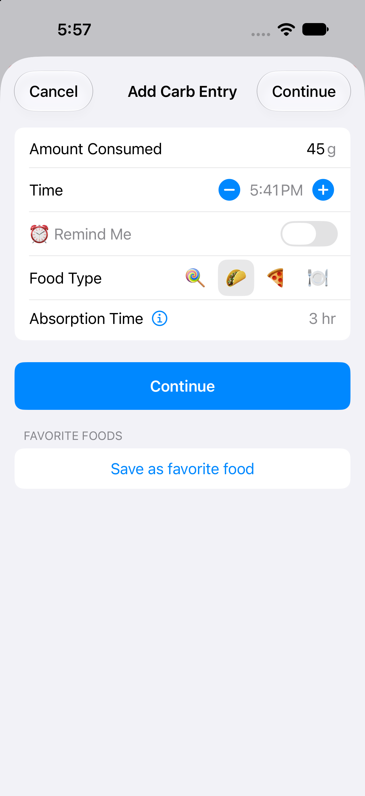
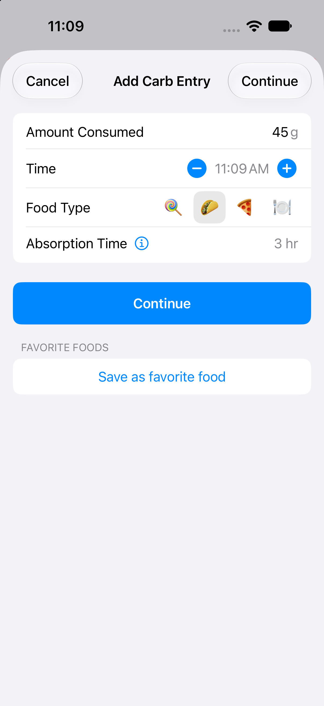
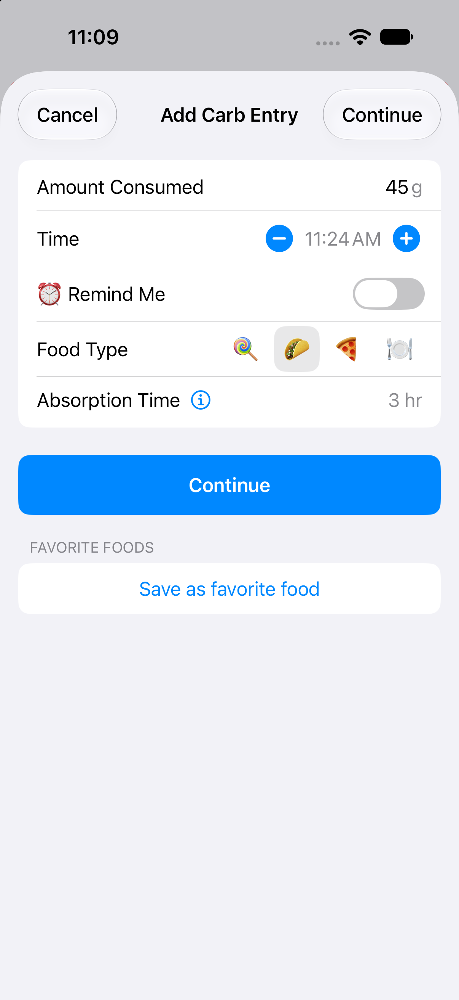
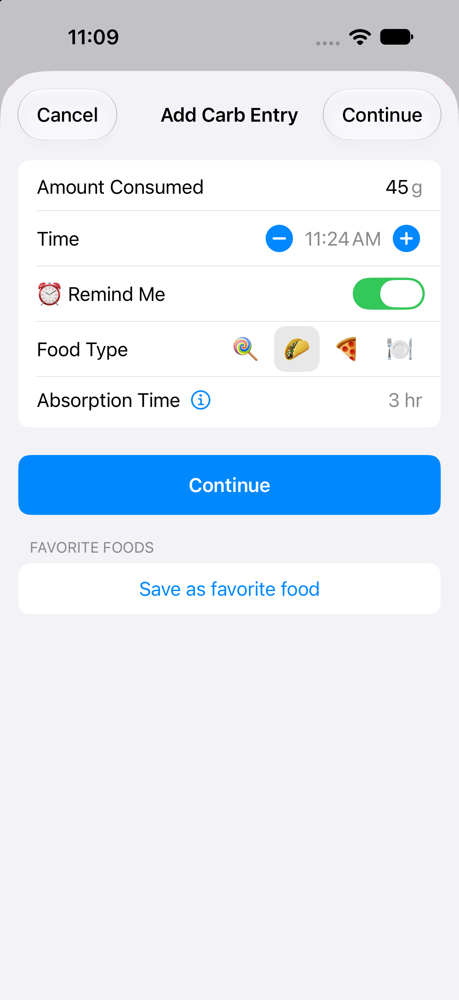
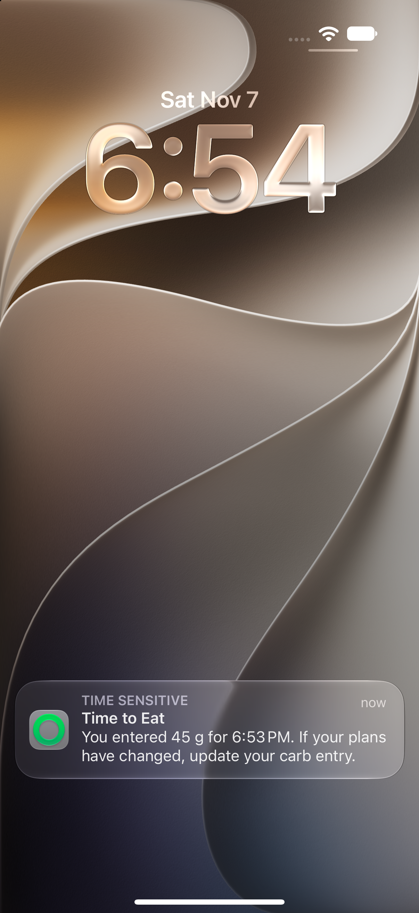
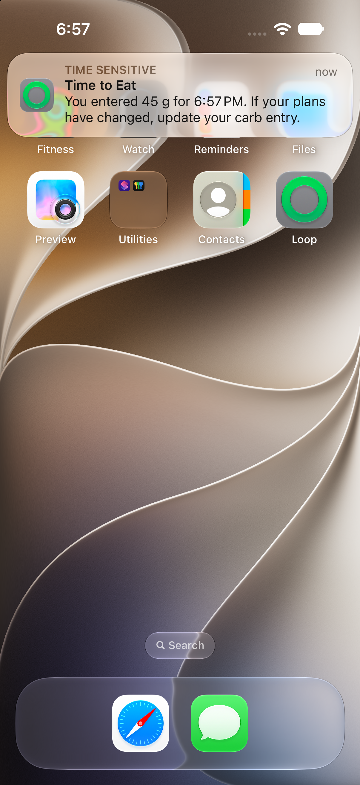

# Future meal reminder toggle

Captured from the actual carb entry screen on an iPhone 18 Pro simulator running iOS 27.2, using a 45 g demo meal.

| Past | Present | Future |
| --- | --- | --- |
|  |  |  |

The status-bar clock provides the current time. The present screenshot shows the default entry time within the same displayed minute.

The toggle starts off for new entries and is enabled only when the entry timestamp is strictly later than the current time. Moving a selected reminder back to the present or past disables the toggle and clears the selection. The reminder is scheduled after the carb entry is saved.

Interactive checks confirmed the toggle becomes available when advancing the entry time and returns to its disabled state when moving it back.

## Time to Eat notification

Loop delivered these reminders for 45 g demo meals saved without a bolus.

| Lock screen | Home screen banner |
| --- | --- |
|  |  |
